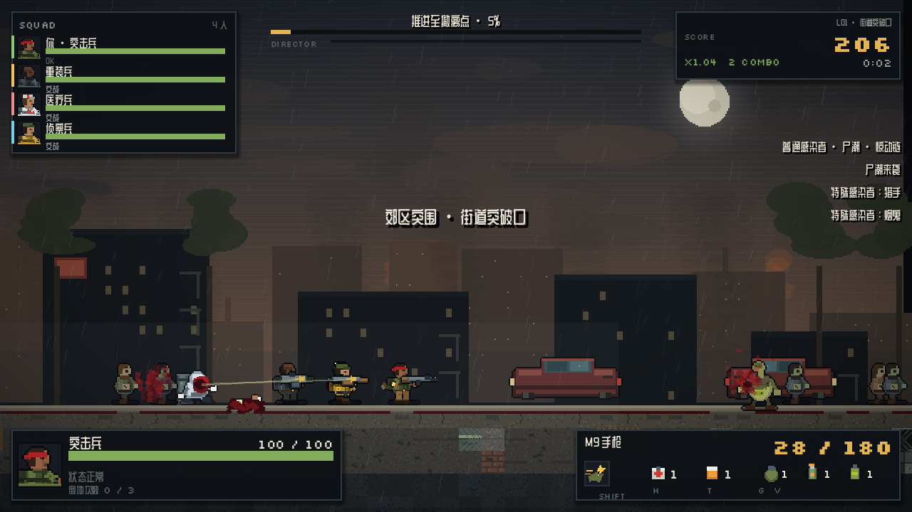
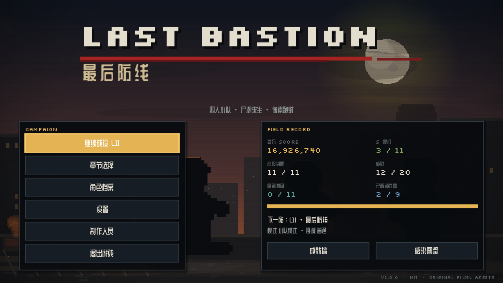
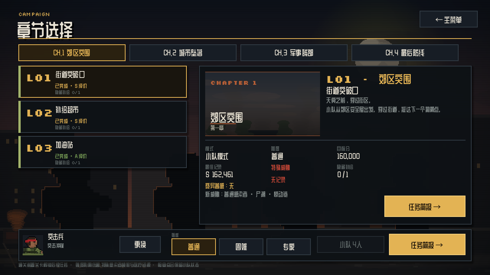
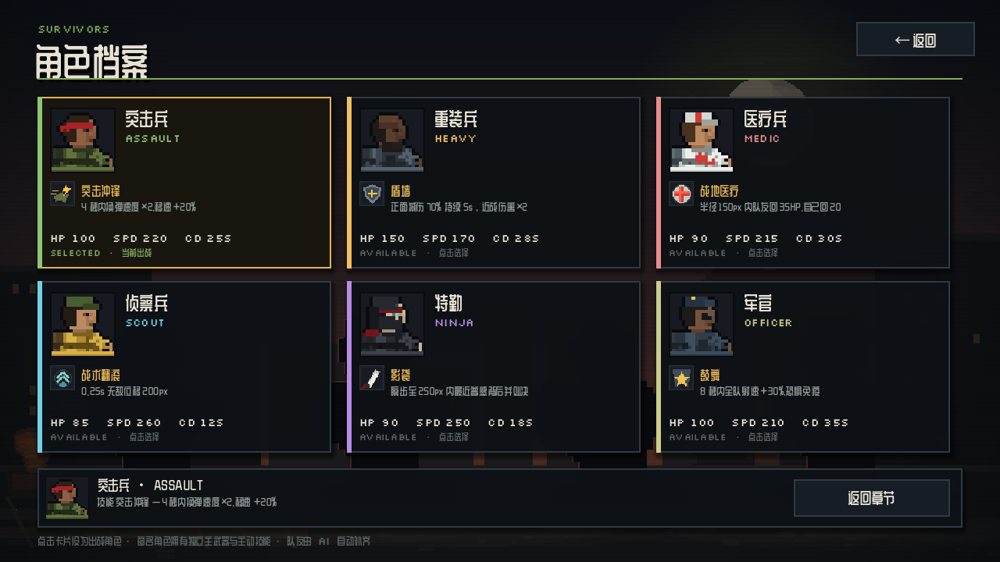
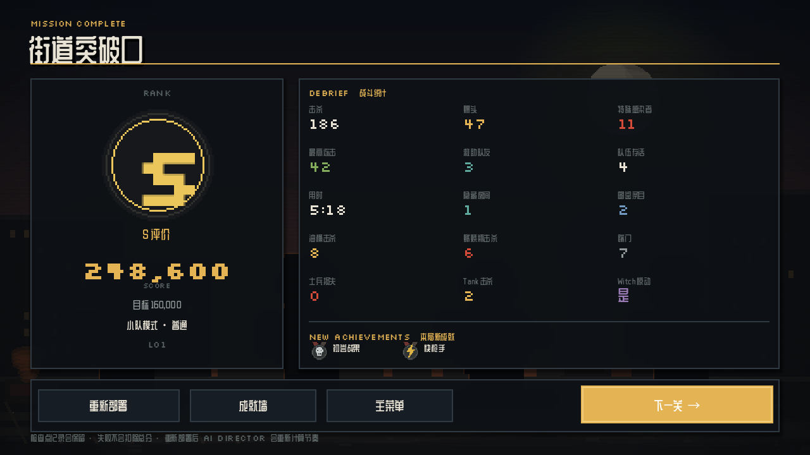
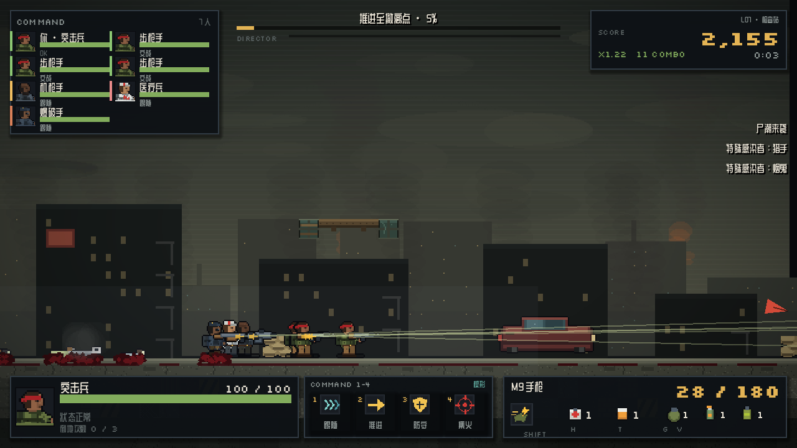
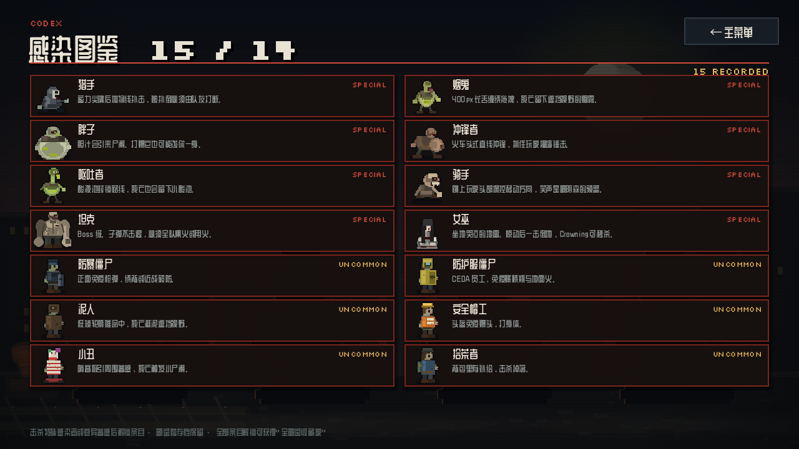

# LAST BASTION · 最后防线

> 2D 像素横版丧尸突围动作射击 —— 街机式扫射 × 四人小队求生 × 军方大部队指挥。
> 使用 **Godot 4.7.2** 与 **GDScript** 构建，全部美术与音频为原创程序化素材。

[](https://godotengine.org)
[](https://docs.godotengine.org)
[](LICENSE)
[](#下载与运行)



## 目录

- [游戏特色](#游戏特色)
- [下载与运行](#下载与运行)
- [操作方式](#操作方式)
- [战役与模式](#战役与模式)
- [敌人图鉴](#敌人图鉴)
- [角色与武器](#角色与武器)
- [系统深度](#系统深度)
- [开发与测试](#开发与测试)
- [导出构建](#导出构建)
- [项目结构](#项目结构)
- [素材与许可](#素材与许可)

## 游戏特色

- **横版 run-and-gun**：640×360 像素画面，踹门、窗户绳降、滑铲、跳跃缓冲、土狼时间、斜向射击、近战推开、可破坏木箱与爆炸油桶。
- **8 种特殊感染者**：Hunter、Smoker、Boomer、Charger、Spitter、Jockey、Tank、Witch，全部拥有独立行为脚本、标志音效与反制手段。
- **6 种变异普通感染者**：防暴、CEDA 防护服、泥人、安全帽工、小丑、拾荒者，各自拥有抗性或特殊掉落。
- **双 AI 队友模式**：四人小队模式会救人、递药、掩护；军方指挥模式可带 4–8 名士兵，下达跟随/推进/防守/集火指令并切换楔形/横列/纵队阵型。
- **AI Director**：基于受击、血量、弹药、安全屋与尸潮状态的动态强度模型，自动调度普通感染者、特殊感染者、补给与 Tank 事件。
- **完整战役**：4 章 11 关，含检查点重整、隐藏房间、防守战、撤离战、Boss 战与多结局式结算。
- **成长与收集**：S/A/B/C/D 评级、跨关累计分数解锁、20 项成就、感染者图鉴、最高分记录。
- **自适应音频**：每套主题音乐含 calm / combat / horde / tank 四条同步 stems，随 Director 强度淡入淡出；105 个 OGG 音效与音乐全部原创合成。
- **三档难度 + 完整设置**：普通/困难/专家，键位重映射、音量、全屏、震屏、提示开关，JSON 原子存档。
- **开发调试工具**：F10 实时 AI 黑板、F7 视线可视化、F8 生成特感、F9 时间缩放；发布版通过 `OS.is_debug_build()` 自动剔除。

| 主菜单 | 关卡选择 |
|---|---|
|  |  |

| 角色选择 | 结算评级 |
|---|---|
|  |  |

| 指挥模式 HUD | 感染者图鉴 |
|---|---|
|  |  |

## 下载与运行

### 直接运行发行版

从 [Releases](https://github.com/chenmoulaile/last-bastion/releases/latest) 下载对应平台压缩包：

| 平台 | 文件 | 说明 |
|---|---|---|
| Windows x86_64 | `LastBastion-windows.zip` | 解压后运行 `LastBastion.exe`，单文件内嵌 PCK |
| Linux x86_64 | `LastBastion-linux.zip` | 解压后运行 `LastBastion.x86_64`，单文件内嵌 PCK |
| macOS Universal | `LastBastion-macos.zip` | 解压后打开 `LastBastion.app`（未签名，首次运行需右键打开） |
| Web | `LastBastion-web.zip` | 解压后启动任意静态 HTTP 服务，打开 `index.html` |

> Web 版需要浏览器支持 WebGL 2。由于浏览器安全策略，请通过 HTTP 服务访问，不要直接双击 `index.html`。

### 从源码运行

1. 安装 [Godot 4.7.2 stable](https://godotengine.org/download)（标准版即可，无需 .NET）。
2. 克隆仓库：

   ```bash
   git clone https://github.com/chenmoulaile/last-bastion.git
   cd last-bastion
   ```

3. 用 Godot 导入 `project.godot`，按 **F5** 运行。
4. 首次导入会生成 `.godot/` 缓存；项目已启用 ETC2/ASTC 以支持 macOS Universal 导出。

**最低配置**：Windows 10 / 主流 Linux 发行版 / macOS 10.12+（Apple Silicon 需 11+）；支持 OpenGL 3.3 的显卡；约 600 MB 内存预算。

## 操作方式

所有键位都可以在 **设置 → 键位** 中重映射；手柄使用标准 Xbox 布局。

| 动作 | 键盘/鼠标 | 手柄 |
|---|---|---|
| 移动 | `A` / `D` | 左摇杆 |
| 跳跃 | `Space` | `A` |
| 蹲下 / 滑铲 | `S` | `B` |
| 瞄准 | 鼠标 / `W` `S` | 右摇杆 |
| 开火 | 鼠标左键 / `J` | 右扳机 |
| 近战推开 | `F` | 右摇杆按下 |
| 换弹 | `R` | `Y` |
| 切换武器 | `Q` | 左肩键 |
| 投掷物 | `G` | 右肩键 |
| 切换投掷物 | `V` | 左摇杆按下 |
| 手电开关 | `L` | `Back` |
| 互动 / 救助 / 踹门 / 绳降 | `E` | `X` |
| 角色技能 | `Shift` | 左扳机 |
| 医疗包 | `H` | — |
| 药丸 | `T` | — |
| 暂停 | `Esc` | `Start` |
| 指挥：跟随 / 推进 / 防守 / 集火 | `1` / `2` / `3` / `4` | 十字键 |
| 切换阵型（指挥模式） | `Tab` | — |
| 调试面板 | `F10` | — |
| 调试视线 / 生成特感 / 时间缩放 | `F7` / `F8` / `F9` | — |

> 调试快捷键仅在编辑器/调试构建中生效，发布版不注册对应逻辑。

## 战役与模式

### 四章十一关

| 章节 | 关卡 | 默认模式 | 主题 |
|---|---|---|---|
| CH.1 郊区突围 | L01 街道突破口 | 小队 | 雨夜街区 |
| | L02 补给超市 | 小队 | 超市搜刮 |
| | L03 加油站 | 小队 | 油桶与火焰 |
| CH.2 城市废墟 | L04 写字楼 | 小队 | 垂直楼宇 |
| | L05 地铁隧道 | 小队 | 黑暗、Witch |
| | L06 天台撤离 | 小队 | 防守与直升机 |
| CH.3 军事基地 | L07 检查站 | 指挥 | 收拢残部 |
| | L08 仓库清剿 | 指挥 | 电锯、窄口防守 |
| | L09 装甲突围 | 指挥 | 跟随 APC |
| CH.4 最后防线 | L10 大桥决战 | 小队 | 桥头尸潮 |
| | L11 最后防线 | 小队 | 120 秒撤离防守 |

### 小队模式（SQUAD）

四人小队，AI 会按优先级执行：救助倒地队友 → 解救被控制队友 → 交战 → 跟随玩家。队友会使用医疗包、拾取补给，并在玩家倒地时前来救援。

### 指挥模式（COMMAND）

玩家指挥 4–8 名士兵，按 `1`–`4` 下达指令，按 `Tab` 循环阵型：

- **跟随**：围绕玩家展开。
- **推进**：向前压上，适合清点。
- **防守**：守住当前位置，适合防守战。
- **集火**：向玩家准星方向集中火力。
- **阵型**：楔形（均衡）/ 横列（宽正面）/ 纵队（窄通道）。

士兵会永久阵亡，L09 无阵亡通关可解锁「老班长」成就。

### 难度

| 难度 | 敌人伤害 | 特感间隔 | 倒地上限 | 友军伤害 | 医疗包效率 |
|---|---|---|---|---|---|
| 普通 | 1.0× | 1.3× | 3 | 关 | 100% |
| 困难 | 1.5× | 1.0× | 2 | 关 | 75% |
| 专家 | 2.0× | 0.75× | 1 | 开 | 75% |

## 敌人图鉴

### 8 种特殊感染者

| 特感 | 战术角色 | 反制 |
|---|---|---|
| Hunter | 飞扑压制 | 侧移、近战打断、击杀 |
| Smoker | 烟雾拖拽 | 打断舌头、躲避烟团 |
| Boomer | 胆汁吸引尸潮 | 保持距离、击杀避免爆炸 |
| Charger | 冲锋抓取 | 跳跃/侧移、近战打断 |
| Spitter | 酸液区域封锁 | 离开酸池、优先击杀 |
| Jockey | 骑乘控制 | 队友近战、挣脱 |
| Tank | 高血量 Boss | 集火、油桶、燃烧瓶 |
| Witch | 高危中立单位 | 关灯绕行；爆头 Crown 秒杀 |

### 6 种变异普通感染者

防暴僵尸（正面免弹）、CEDA 防护服（抗火焰）、泥人（高韧性）、安全帽工（硬直抗性）、小丑（惊动周围）、拾荒者（掉落额外分数与弹药）。

## 角色与武器

### 6 名可玩角色

| 角色 | 定位 | 技能 | 解锁 |
|---|---|---|---|
| 突击兵 | 均衡 | 突击冲锋 | 初始 |
| 重装兵 | 坦克 | 盾墙 | 初始 |
| 医疗兵 | 支援 | 战地医疗 | 初始 |
| 侦察兵 | 机动 | 战术翻滚 | 初始 |
| 特勤 | 刺客 | 影袭 | 100,000 累计分 |
| 军官 | 指挥 | 鼓舞 | 任意 3 关取得 S 评价 |

指挥模式另含爆破手、机枪手、步枪手、战地医疗兵四种士兵角色。

### 武器

- **6 把枪**：M9 手枪、SMG、AR-15、泵动霰弹枪、LMG、狙击步枪。
- **3 把近战**：消防斧、武士刀、电锯。
- **3 种投掷物**：手雷、燃烧瓶、胆汁瓶。

所有武器数值位于 `resources/data/weapons/*.tres`，支持命中衰减、散布、穿透、弹丸数、爆头与换弹。

## 系统深度

- **倒地 / 救助 / 黑白 / 死亡**：L4D2 式倒地计时、队友救援、医疗包复活、黑白视野与濒死。
- **检查点**：每关中途检查点，全灭后小队在检查点重整（每检查点一次）。
- **隐藏房间**：每关至少一个隐藏补给点，计入「拾荒者」成就。
- **防守 / 撤离**：L06 天台防守、L11 最终 120 秒撤离，HUD 显示倒计时与波次。
- **评分**：`总分 = 关卡基础分 100,000 + 击杀分（连击倍率最高 ×5）+ 时间奖励 − 超时罚 + 无伤奖励 + 救助奖励`；击杀、爆头、连击、救援、踹门、隐藏房间、Boss 击杀时间共同决定分数与 S/A/B/C/D 评级。
- **解锁**：累计分数解锁特勤、LMG、狙击、+1 手雷上限与称号。
- **20 项成就**：首通、踹门、Crown、Tank 速杀、50 连击、全武器、无阵亡指挥、50 次救援、专家全通、8 人满编、潜行、零倒地、全图鉴、全隐藏房间、油桶、燃烧瓶、Hunter 打断、Boomer、胆汁、S 评级等。
- **存档**：`user://save/save_01.json`，原子写入（临时文件 + rename），自动合并旧版本字段。
- **音频**：105 个 OGG；音乐按 Director 强度分层，Tank 出场时坦克层独占。

## 开发与测试

### 环境

- Godot **4.7.2 stable**（标准版，GDScript）
- 渲染器：**Compatibility (OpenGL 3.3)**
- 内部分辨率：**640×360**，窗口默认 1280×720，`canvas_items` 拉伸
- 无第三方运行时依赖

### 自动化测试

三个 headless 测试场景覆盖菜单、11 关战役、交互物、检查点、防守、撤离、音频分层、存档、成就、解锁、评分公式、生成上限与调试工具。

```bash
GODOT=/path/to/Godot_v4.7.2-stable_win64.exe

$GODOT --headless --path . res://tests/smoke.tscn
$GODOT --headless --path . res://tests/campaign.tscn
$GODOT --headless --path . res://tests/integration.tscn
```

最近一次结果（2026-10-26）：

| 测试 | 检查项 | 失败 |
|---|---|---|
| Smoke | 32 | 0 |
| Campaign | 209 | 0 |
| Integration | 91 | 0 |

### 性能门禁

```bash
$GODOT --path . --resolution 1280x720 res://tests/performance.tscn
```

测试会关闭 vsync，生成 120 只普感 + 4 只特感，采样 5 秒。最近结果（Intel Arc，1280×720）：

```text
[PERF] frames=4066 avg_fps=813.2 min_fps=72.4 commons=111 specials=3
[PERF] draw_calls=201 memory=82.0MB peak=82.1MB
[PERF] RESULT: PASS
```

正常游玩时开启 vsync，帧率由显示器刷新率决定；测试关闭 vsync 是为了测量真实帧预算。完整测试说明见 [docs/TESTING.md](docs/TESTING.md)。

### 截图回归

```bash
$GODOT --path . --resolution 1280x720 res://tests/screenshot.tscn
```

截图输出到 `build/screens/`，用于视觉回归与文档配图。

### 调试面板

在调试构建中按 `F10` 打开：

- 实时显示 FPS、Draw Calls、Director 强度、尸潮/安全屋状态、同屏感染者与特感数量。
- 右侧显示每名 AI 的血量、状态、指令、当前目标。
- `F7` 切换玩家准星射线与队友目标连线。
- `F8` 在鼠标位置生成随机特感。
- `F9` 在 0.25× / 1× / 2× 之间切换时间缩放。

发布版不会创建调试面板，也不会注册调试按键逻辑。

## 导出构建

`export_presets.cfg` 已包含四个预设，Windows/Linux 使用内嵌 PCK 单文件：

```bash
$GODOT --headless --path . --export-release "Windows Desktop" build/windows/LastBastion.exe
$GODOT --headless --path . --export-release "Linux" build/linux/LastBastion.x86_64
$GODOT --headless --path . --export-release "macOS" build/macos/LastBastion.zip
$GODOT --headless --path . --export-release "Web" build/web/index.html
```

macOS Universal 导出要求项目设置 `rendering/textures/vram_compression/import_etc2_astc=true`，仓库已启用。

## 项目结构

```text
.
├── autoload/                 # 6 个固定顺序单例
│   ├── event_bus.gd
│   ├── game_manager.gd
│   ├── director_system.gd
│   ├── audio_manager.gd
│   ├── save_system.gd
│   └── config_manager.gd
├── resources/data/           # 所有数值表（角色/武器/僵尸/关卡/成就/难度）
├── scenes/                   # 主流程、菜单、关卡、角色、僵尸、UI
├── scripts/                  # 玩家、僵尸、AI、关卡、交互物、UI、工具
├── assets/                   # 原创像素图、105 个 OGG、字体与许可
├── tools/                    # Python/Pillow/NumPy/FFmpeg 素材生成器
├── tests/                    # smoke / campaign / integration / screenshot
├── docs/                     # 规格书、验收记录、截图
├── export_presets.cfg
├── DECISIONS.md
├── THIRD_PARTY_NOTICES.md
├── LICENSE
└── project.godot
```

### Autoload 顺序

`EventBus → GameManager → DirectorSystem → AudioManager → SaveSystem → ConfigManager`

事件通过 `EventBus` 解耦；Director 只发指令，不直接操作关卡节点；HUD 只读展示状态。

## 素材与许可

- **代码、像素美术、音频、图标**：MIT License，见 [LICENSE](LICENSE)。
- **字体**：Silkscreen、ZCOOL QingKe HuangYou、Noto Sans SC，SIL OFL 1.1；完整版权与许可见 [`assets/licenses/OFL.txt`](assets/licenses/OFL.txt)。
- **第三方声明**：见 [THIRD_PARTY_NOTICES.md](THIRD_PARTY_NOTICES.md)。
- **参考与灵感**：本作参考了《求生之路 2》的协作丧尸生存玩法与官方公开截图，但**不包含任何 Valve 的美术、音频、地图或模型素材**。所有游戏内资源均由 `tools/` 下的脚本原创生成。
- 《Left 4 Dead 2》是 Valve Corporation 的商标；本项目与 Valve 无关联，也未获得其背书。

## 文档

- [开发规格书](docs/AI_DEVELOPMENT_SPEC.md)
- [v1.0 验收记录](docs/ACCEPTANCE_v1.0.md)
- [决策记录](DECISIONS.md)
- [测试说明](docs/TESTING.md)

## Roadmap

- [x] M0 工程骨架
- [x] M1 玩家核心
- [x] M2 普通感染者系统
- [x] M3 八种特殊感染者
- [x] M4 小队 AI
- [x] M5 指挥模式 AI
- [x] M6 11 关战役
- [x] M7 UI / 存档 / 成就
- [x] M8 音频与表现打磨
- [x] M9 v1.0 发布（Windows / Linux / macOS / Web）

---

**LAST BASTION · 最后防线** — 守住这里。直升机是最后的答案。
